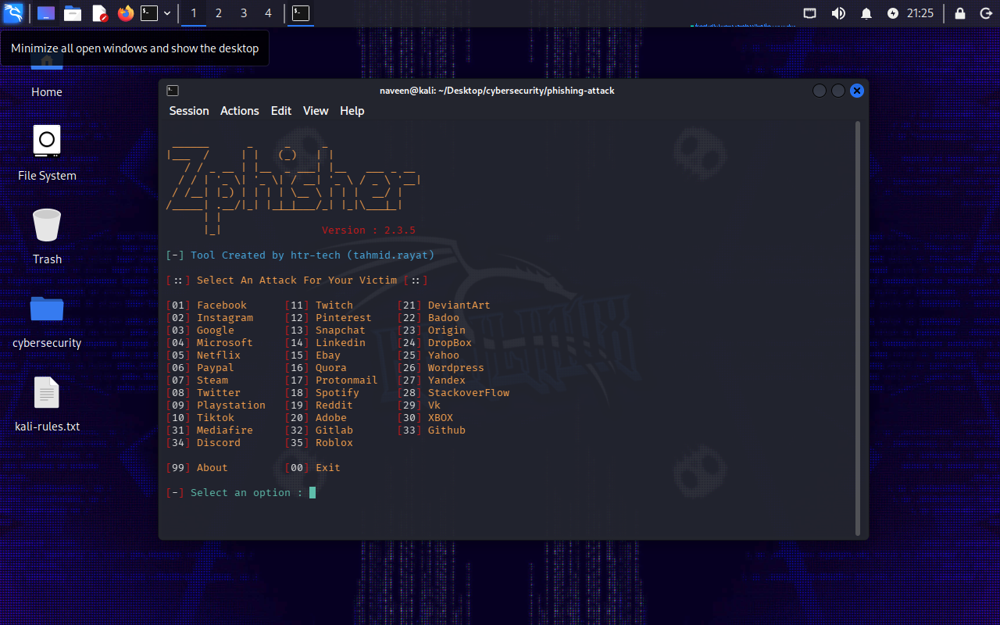
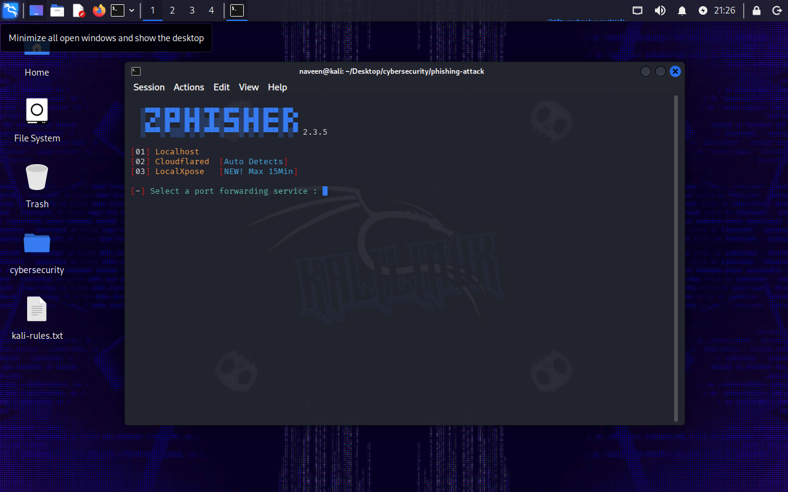
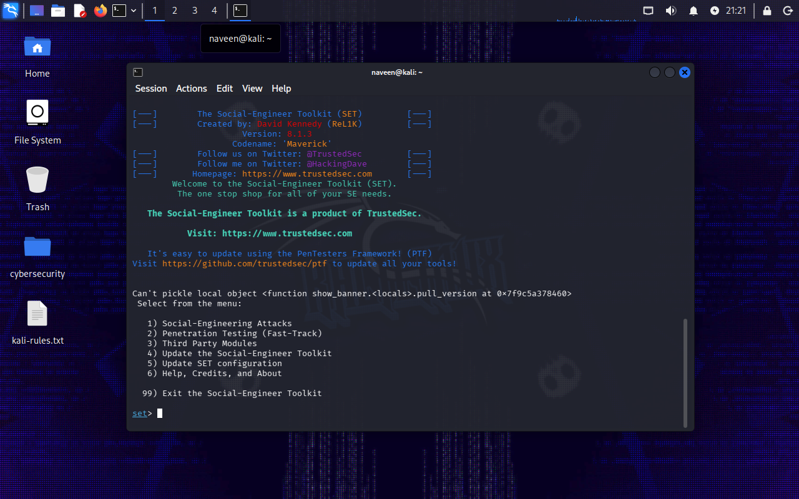
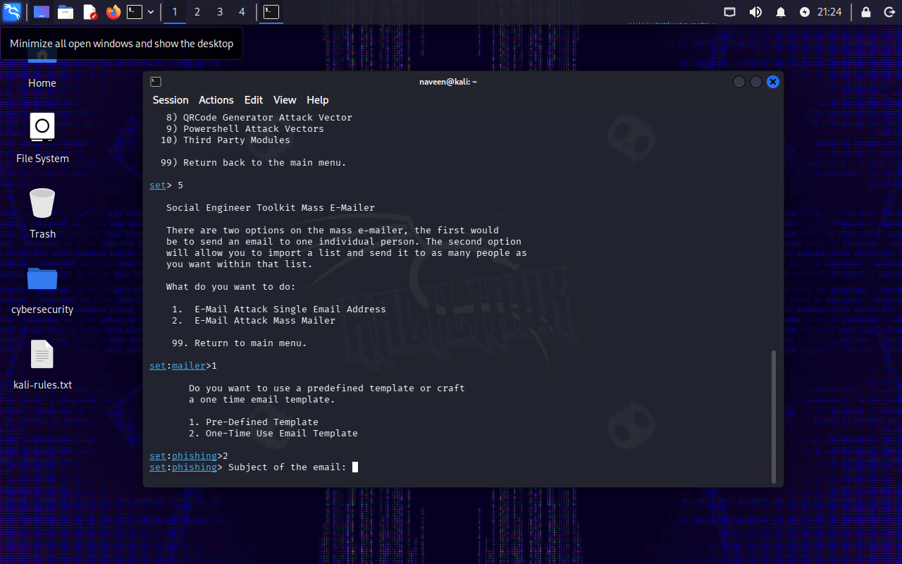

# Phishing Simulation & Social Engineering Lab

**Author:** Naveen Kumar S  
**Date:** 18 October 2026

A documentation-focused cybersecurity lab exploring phishing-page workflows and email-related social-engineering workflows using Kali Linux, Zphisher, and the Social-Engineer Toolkit (SET).

## Project Overview

This repository contains the project report and screenshots documenting the tool interfaces explored, key security observations, and defensive recommendations.

## Tools and Scope

- **Kali Linux** — testing environment shown in the screenshots.
- **Zphisher** — explored the page-template menu and access/tunneling options.
- **Social-Engineer Toolkit (SET)** — explored the main interface and email-related workflow.

This repository documents tool exploration and security learning. It does not claim that credentials were collected or that an account was compromised.

## Screenshots

### Zphisher — Template Selection

### Zphisher — Access and Tunneling Options

### Social-Engineer Toolkit — Main Interface

### Social-Engineer Toolkit — Email-Related Workflow

## Full Project Report

[Open the project report (PDF)](docs/phishing-social-engineering-project.pdf)

## Key Security Takeaways

- A familiar-looking login page does not establish that a website is legitimate.
- Email-based social engineering can exploit urgency, familiarity, and apparent authority.
- Exposed credentials can lead to additional account compromise.
- Domain verification, phishing-resistant authentication, email security, user reporting, and account monitoring can help reduce risk.

## Ethical Use

This project is intended for cybersecurity education and authorized testing only. Use controlled infrastructure, consenting participants, and synthetic credentials. Do not collect or publish real credentials, personal information, or live phishing links without explicit authorization.

## Author

- **Portfolio:** https://naveenkumars.vercel.app/
- **LinkedIn:** https://www.linkedin.com/in/thephotogenicbug/
- **GitHub:** https://github.com/thephotogenicbug
